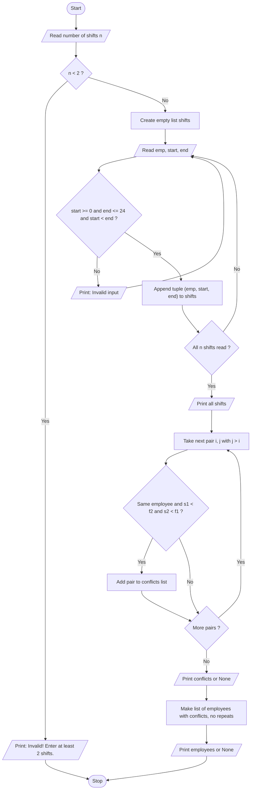

# Tuple-Based Employee Shift Conflict Detection

**Case No:** 48
**Folder:** `48_Shift_Conflicts`
**Source code:** [`Solution.py`](Solution.py)

---

## 1. Problem Statement

Represent employee shifts as tuples, compare their time intervals, detect overlapping assignments, and identify the employees who have conflicting schedules.

## 2. Objectives

- To store each shift as a tuple `(employee, start hour, end hour)` and keep all shifts in a list.
- To use tuple unpacking to read the values of each shift.
- To compare every pair of shifts using nested loops and detect overlapping time intervals.
- To report all conflicts and list each employee with a conflict only once.
- To validate the inputs (number of shifts and shift timings).

## 3. Assumptions

- Each shift is a tuple: `(employee, start hour, end hour)`.
- Hours range from 0 to 24, and the start hour must be less than the end hour.
- Two shifts of the **same employee** that overlap are a conflict.
- If one shift ends exactly when another starts (for example, 12 and 12), it is **not** a conflict.
- Overlapping shifts of different employees are not a problem.
- At least 2 shifts are required.

## 4. Algorithm

1. Start.
2. Read the number of shifts `n`.
3. If `n < 2`, display "Invalid! Enter at least 2 shifts." and stop.
4. Create an empty list `shifts`.
5. Repeat `n` times:
   1. Read the employee name, start hour and end hour.
   2. If the start is below 0, the end is above 24, or start is not less than end, display an error and read again.
   3. Store `(emp, start, end)` as a tuple in `shifts`.
6. Display all shifts using tuple unpacking.
7. For every pair of shifts `i` and `j` (with `j > i`), unpack them as `e1, s1, f1` and `e2, s2, f2`.
8. If `e1 == e2` and `s1 < f2` and `s2 < f1`, store the conflict.
9. Display all conflicts, or "None" if there are no conflicts.
10. Build a list of employees with conflicts without repeating names, and display it (or "None").
11. Stop.

## 5. Flowchart



## 6. Pseudocode

```
START
    READ n
    IF n < 2 THEN
        PRINT "Invalid! Enter at least 2 shifts."
    ELSE
        shifts = empty list
        FOR i = 1 TO n
            READ emp
            REPEAT
                READ start, end
            UNTIL start >= 0 AND end <= 24 AND start < end
            ADD tuple (emp, start, end) TO shifts
        END FOR

        PRINT all shifts

        conflicts = empty list
        FOR i = 0 TO n - 1
            FOR j = i + 1 TO n - 1
                (e1, s1, f1) = shifts[i]
                (e2, s2, f2) = shifts[j]
                IF e1 == e2 AND s1 < f2 AND s2 < f1 THEN
                    ADD (e1, s1, f1, s2, f2) TO conflicts
                END IF
            END FOR
        END FOR

        PRINT conflicts, or "None" if empty

        bad = empty list
        FOR each conflict c IN conflicts
            IF c.employee NOT IN bad THEN
                ADD c.employee TO bad
            END IF
        END FOR

        PRINT bad, or "None" if empty
    END IF
STOP
```

## 7. Python Source Code

The complete program is in [`Solution.py`](Solution.py).

**Concepts used:** tuples, list of tuples, tuple unpacking (`e1, s1, f1 = shifts[i]`), nested loops (`for j in range(i + 1, n)` so each pair is compared only once), input validation with `while True`, and the overlap rule `s1 < f2 and s2 < f1`.

**How to run:**

```
python Solution.py
```

## 8. Test Cases

| TC | Type | Input (in order) | Expected Output |
|----|------|------------------|-----------------|
| 1 | Conflict | shifts 4, then Ravi 9 13, Ravi 12 16, Sita 9 17, Kiran 10 14 | Ravi has a conflict |
| 2 | No conflict | shifts 3, then Ravi 9 12, Ravi 12 15, Sita 9 12 | Conflicts: None |
| 3 | Invalid | shifts 1 | Invalid! Enter at least 2 shifts. |

**TC 1 output**

```
--- Shifts ---
Ravi 9 to 13
Ravi 12 to 16
Sita 9 to 17
Kiran 10 to 14

--- Conflicts ---
Ravi: 9-13 overlaps with 12-16

Employees with conflicts:
Ravi
```

Sita (9-17) and Kiran (10-14) overlap, but they are different employees, so no conflict is counted.

**TC 2 output**

```
--- Shifts ---
Ravi 9 to 12
Ravi 12 to 15
Sita 9 to 12

--- Conflicts ---
None

Employees with conflicts:
None
```

Ravi's shifts 9-12 and 12-15 only touch at hour 12: `9 < 15` is true but `12 < 12` is false, so there is no conflict.

**TC 3 output**

```
Invalid! Enter at least 2 shifts.
```

## 9. Output Screenshots

| Test case | Screenshot |
|-----------|------------|
| TC 1 | `screenshots/tc1.png` |
| TC 2 | `screenshots/tc2.png` |
| TC 3 | `screenshots/tc3.png` |

## 10. Conclusion

The program stores each shift as a tuple and compares every pair of shifts exactly once using nested loops. It correctly detects overlapping shifts of the same employee, ignores overlaps between different employees, and treats shifts that only touch at the boundary (such as 12 and 12) as non-conflicting. Input validation handles an invalid number of shifts and invalid timings. All three test cases produced the expected output, so the solution meets the requirements of the case study.